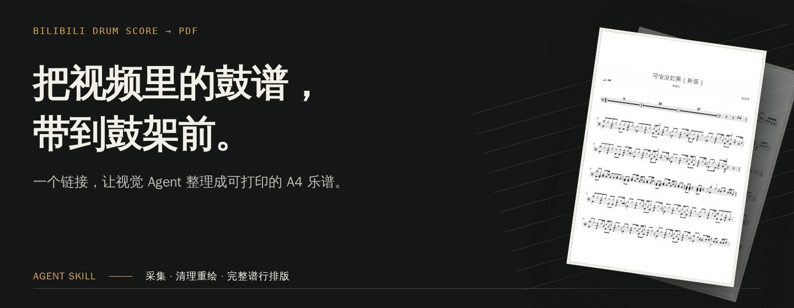
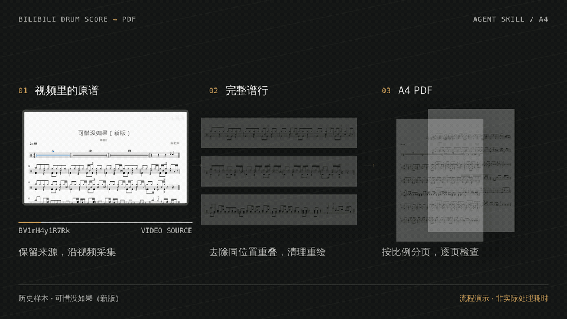
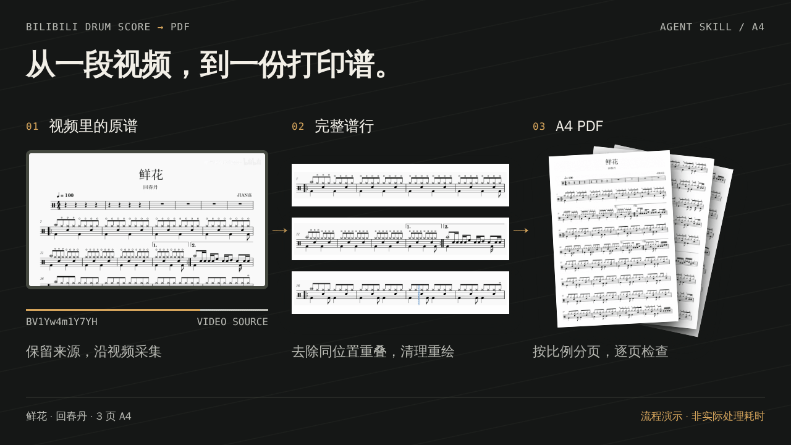

<p align="center">
  
</p>

<p align="center">
  从已有鼓谱的视频，到可以打印的 A4 乐谱。<br>
  给视觉 Agent 一个链接，完成采集、清理、重排与逐页检查。
</p>

<p align="center">
  <a href="https://github.com/kenqia/bilibili-drum-score-to-pdf/actions/workflows/offline.yml"></a>
  
  
  <a href="LICENSE"></a>
</p>

<p align="center">
  <a href="#开始使用">开始使用</a> ·
  <a href="#看看结果">看看结果</a> ·
  <a href="#适合什么视频">支持范围</a> ·
  <a href="llms.txt">给 AI 的检索入口 / For agents</a> ·
  <a href="docs/README.md">文档导航</a>
</p>

## 把时间留给练习

练一首歌，不该先花时间拖进度条、截屏、裁图，再把零散的谱面拼起来。

这个项目把这段工作交给视觉 Agent。它优先读取行首小节号定位，沿视频收集完整谱行，去掉同一位置的重叠截图，清理谱面，再按原比例排成 A4。标题、速度、拍号和后续重复出现的音乐都需要保留。交付前，Agent 实际查看最终每一页。

它是一个 **Agent Skill**。本地脚本处理视频、来源记录和排版，宿主 Agent 负责视觉判断与生图。已有 Codex 整曲验证记录，其他宿主尚未完成整曲验收。

## 看看结果



<p align="center"><sub>12 秒静音循环 · 使用已保存的真实样本 · 流程演示</sub></p>

示例为实际转换并逐页检查的《鲜花》，演唱者为回春丹。原视频水印署名「帅气迷人的小磊子」，谱面署名「JIAN磊」。[查看原视频](https://www.bilibili.com/video/BV1Yw4m1Y7YH) · [下载三页 A4 PDF](docs/media/readme/assets/xianhua/xianhua-A4.pdf) · [查看来源与审阅记录](docs/media/readme/assets/xianhua/provenance.json)。音乐与谱面权利归原权利人。

<details>
<summary>查看静态流程图与实际 PDF 页面</summary>



下面是《鲜花》PDF 的第一页。整份输出共三页，包含 27 条完整谱行，覆盖第 1–113 小节并保留反复结构。


本次实际查看了原生来源、四组宿主重绘结果和最终全部三页。谱行接续通过小节号与重叠谱行核对。

</details>

## 开始使用

### 1. 安装后这样用

在宿主输入框中选中 [$bilibili-drum-score-to-pdf](skills/bilibili-drum-score-to-pdf/SKILL.md)，然后粘贴视频链接。例如在 Codex 中输入 `$`，从可用 Skill 中选择本项目，再发送：

```text
$bilibili-drum-score-to-pdf

https://www.bilibili.com/video/BV1Yw4m1Y7YH/

整理成 A4 PDF，保存到我指定的目录。
```

上面的 Skill 链接用于查看指令文件；实际选择发生在宿主输入框中，无需复制任何人的本地安装路径。只提供 Skill 和链接也可以启动默认 PDF 流程。未指定保存位置时，Agent 在当前工作目录下创建独立任务目录，交付时报告绝对路径。

也可以提供本地视频的绝对路径。公开 B站链接支持 `?p=2` 分 P。采集、整理、完整谱行排版和逐页检查由 Skill 指导 Agent 执行，用户无需填写任务 JSON。该链接也是上方《鲜花》展示的实际来源。

### 2. 还没安装？

把下面这段话发给有文件读写和脚本运行能力的 Agent：

```text
请安装这个仓库中的 bilibili-drum-score-to-pdf Skill：
https://github.com/kenqia/bilibili-drum-score-to-pdf

先读取 docs/install.md，将 skills/bilibili-drum-score-to-pdf
整个目录安装到当前宿主能发现 Skill 的位置。
请一起保留 SKILL.md、scripts/、references/ 和 LICENSE，
检查运行依赖；更新已有安装时先保留可恢复副本。

安装后确认它出现在宿主的技能列表或选择器中，
并报告安装位置、源码版本和验证结果。
```

对外 Skill 是自包含目录，执行所需协议随 `references/` 一起分发，运行时无需源码仓库的 `docs/`。依赖 Python 3.12、uv、FFmpeg、ffprobe 和 Poppler；宿主需要实际查看原生图片及 PDF 页面。代码开源，宿主 AI 服务可能收费。

手动安装、受管理安装与回滚见[安装指南](docs/install.md)。不同宿主的发现位置和调用界面不同，其他宿主尚未完成整曲验收。

### 3. 怎样确认安装成功？

让 Agent 核对以下事项，而不只是报告“文件已下载”：

- 宿主技能列表或选择器能找到并选中 `bilibili-drum-score-to-pdf`。未出现时重新加载或重启宿主后再核对。
- 已安装目录内的 `SKILL.md`、`scripts/convert.py` 和 `references/stage-recovery-layout.md` 存在且可读。
- 在安装目录中运行下面的帮助命令，退出成功并显示 `stage`、`export`、`review-pdf` 等操作；同时核对 FFmpeg、ffprobe、Poppler 与宿主看图能力。

```sh
uv run --python 3.12 --isolated --with-requirements scripts/requirements.txt \
  python scripts/convert.py --help
```

这些检查证明安装和入口可用。具体视频仍需通过来源检查和最终全部页面审阅，才能交付完整 PDF。

### 4. 开发者入口

<details>
<summary>从命令行准备任务、理解产物与恢复</summary>

在源码仓库根目录执行：

```sh
uv run --python 3.12 --isolated --with-requirements skills/bilibili-drum-score-to-pdf/scripts/requirements.txt \
  python skills/bilibili-drum-score-to-pdf/scripts/convert.py \
  /absolute/path/to/video.mp4 --output /absolute/path/to/new-task
```

替换两个绝对路径，输出使用新的任务目录。安装目录中使用同一命令的 `scripts/` 相对路径。该命令只准备任务；Agent 随后读取默认 `stage(mode=agent)` 返回的来源任务，自行导航、采集和实际看图，通过 present 与 assemble 确认标题、首尾和接续，再推进宿主生图、结果审阅、导出与最终页面检查。默认不自动扫描；显式 mode=sparse/strict 保留稀疏导航与连续扫描，各自记录真实覆盖。接续疑点局部补采并逐项处理。只有阶段返回 `complete` 才交付。

PDF 位于任务目录的 `exports/<revision>/<谱名>.pdf`。原视频保存在相邻的独立来源目录，原截图和历史结果保留，恢复检查来源与材料 hash。操作请求见[命令入口](skills/bilibili-drum-score-to-pdf/references/reconstruction-entry.md)，正常推进与恢复见[阶段指南](skills/bilibili-drum-score-to-pdf/references/stage-recovery-layout.md)。

</details>

## 它怎样处理一份谱

| 环节 | 实际处理 |
| --- | --- |
| 收集谱面 | 取得完整谱行，记录实际时间戳与来源 hash；同位置重叠去重，后续重复音乐保留。 |
| 清理重绘 | 优先调用宿主生图工具；每个输入版本最多一次定向修正。工具不可用或结果不合格时使用轮廓矢量路线。 |
| 整理打印 | 按来源比例统一排版，只在完整谱行之间分页；可调整边距、最小行距和目标页数。 |
| 检查交付 | Agent 查看全部最终页面，再批准当前输出版本。来源、修正与历史文件保留。 |

看不清的关键记号需要局部补采。轮廓转描无法恢复完全隐藏的音符，也不等于音乐识别。目标页数过少时，程序优先保留完整行与可读比例，并说明实际页数。

## 适合什么视频

| 输入 | 当前支持情况 |
| --- | --- |
| 固定比例、白底多行鼓谱，向上推进或可确认有序翻页 | 已有真实整曲 PDF 记录。 |
| 公开 B站 BV 链接、本地鼓谱视频 | 共用任务入口；链接以匿名方式获取。 |
| 水印、播放高亮或局部遮挡 | 可进入粗拼；关键音乐内容无法确认时补采，未解决则保留待处理状态。 |
| 横向滚动、比例变化或无法确认接续的布局 | 不在当前验证范围内。 |
| 只有演奏画面、没有谱面的视频 | 不支持从音频或演奏动作生成鼓谱。 |

### MIDI 是独立的可选流程

只有你明确要求 MIDI 时，Agent 才加载[音乐转写流程](docs/agents/midi-conversion.md)。当前没有通过可靠整曲 MIDI 的严格准确性门槛。你明确接受近似播放后，可以走近似输出分支，结果标记 `midi_playable`、`reliable=false`，并保留鼓件与节奏假设。MIDI 失败不丢弃已审核 PDF。

## 有哪些验证

已有《KiLLKiSS》《可惜没如果（新版）》和《小星星》的真实 PDF 验收记录，包含宿主生图、来源证据和全部页面查看；另有 KiLLKiSS 强制矢量与遮挡修复记录。[查看验证范围与证据](docs/verification.md)。

这些是指定样本的结果。新的独立标准曲扫描仍有原生单像素疑点，状态保留为 `blocked`；没有用合成测试或旧样本验收替它放行。宿主、输入布局和原始清晰度都会影响可交付结果。

运行仓库验证：

```sh
uv run --python 3.12 --isolated --with-requirements skills/bilibili-drum-score-to-pdf/scripts/requirements.txt \
  --with mido==1.3.3 python -m unittest discover -s tests -v
```

CI 验证合成与确定性产物，不调用宿主模型，不证明音乐准确率。模型成本未知时记录为 `null`。

## 继续阅读与反馈

| 你想做什么 | 从这里开始 |
| --- | --- |
| 安装、更新或回滚 | [安装指南](docs/install.md) |
| 让 AI 判断项目是否适用 | [AI 检索摘要](llms.txt) · [Skill 规范入口](skills/bilibili-drum-score-to-pdf/SKILL.md) |
| 运行与恢复任务 | [阶段指南](docs/agents/stage-recovery-layout.md) · [命令参数](docs/agents/reconstruction-entry.md) |
| 理解实现、贡献改动 | [文档导航](docs/README.md) · [架构](docs/architecture.md) · [项目工作约定](AGENTS.md) |
| 报告问题或提出建议 | [GitHub Issues](https://github.com/kenqia/bilibili-drum-score-to-pdf/issues) |

反馈时请附公开来源或脱敏的复现材料、宿主、失败阶段和预期结果。不要提交 Cookie、认证文件或带签名的媒体地址。

## 许可证与示例署名

代码与原创文档采用 [MIT 许可证](LICENSE)。音乐、谱面及其衍生展示不属于本项目的 MIT 授权范围，权利归原权利人；[展示素材说明](docs/media/readme/README.md)保留来源与署名。
