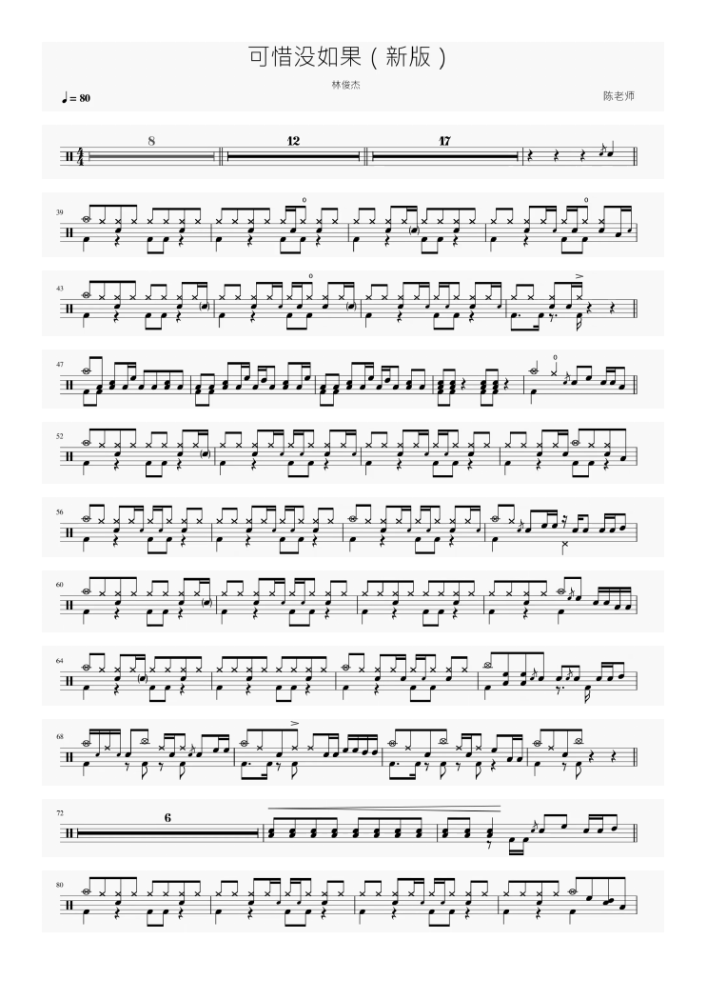

# B站鼓谱视频转 PDF

把视频中已有的鼓谱整理成能打印的 A4 PDF。你给视觉 Agent 一个 B站链接或本地视频，Agent 查看谱面、寻找完整干净的原帧，必要时补采，再核对来源并逐页检查 PDF。

每条谱行来自一张真实视频帧，只转灰度。标题、速度、拍号和行外记号随谱面保留；来源材料记录实际视频时间、裁剪范围和已保存决定。



图为《可惜没如果，新版》历史交付的第一页，完整成品为 12 行、2 页。它是已有交付示例，本轮首发测试另行记录。

## 安装后，把链接交给 Agent

本项目面向已经使用 Codex 等视觉 Agent、愿意安装 Skill 的用户。宿主需要读写本地文件、执行脚本、实际查看原生图像和 PDF 渲染页。运行需要 Python 3.12+、uv、ffmpeg、ffprobe；本项目用 Poppler 渲染和检查 PDF。

复制下面这段话给你的 Agent。

```text
请从 https://github.com/kenqia/bilibili-drum-score-to-pdf 安装
bilibili-drum-score-to-pdf Skill。
保留完整仓库，按当前宿主约定注册 skills/bilibili-drum-score-to-pdf，
确认仓库 docs/agents 协议可读，并检查脚本依赖和看图能力。
报告安装路径、源码版本和检查结果。
```

安装需要完整仓库里的协议文档。详细步骤、检查与回滚见 [安装指南](docs/install.md)。当前已有 Codex 视觉交付记录，其他宿主的整曲兼容性仍待验证。

安装后可直接发任务。

```text
请用 bilibili-drum-score-to-pdf 将这个视频中的鼓谱整理成 A4 PDF：
https://www.bilibili.com/video/BV1rH4y1R7Rk

结果保存到 /absolute/new-result，使用新的任务目录，显式选择 --mode auto。
请自行审阅原图、寻找干净来源、按需补采，并检查整曲顺序和每页 PDF。
用谱面实际标题命名 PDF，保留来源材料。证据不足时说明疑点。
```

将输出占位路径改成你要保存的位置。首发测试使用显式 `auto`；当前省略 mode 的源码默认仍为 `full`。auto 从按需证据开始，先复用本任务干净原帧，再补采和恢复；必要时加强同任务原生审阅。模式细节见 [auto、fast 与 full](docs/agents/workflow-modes.md)。

## 哪些视频适合

支持固定比例、白底多行鼓谱，窗口向上滚动且有可靠重叠，或有序翻页且能确认前后接续。视频里必须已经有谱面。横向滚动、谱面缩放、回跳和没有谱面的演奏视频不在当前范围内。

光标或水印覆盖符号时，需要同一行另一个完整干净的原帧。找不到来源、接续不明或有效分辨率不足时，Agent 保留疑点。脚本生成 PDF 之后仍需实际逐页审核，重放成功不等于整曲质量通过。

## 得到什么

```text
结果目录/
├── 谱名.pdf
└── 材料/
    ├── manifest.json
    ├── decision.json
    └── 原帧、原裁剪和灰度打印图
```

PDF 保持原谱比例，在谱行之间分页。材料可追溯每行视频时间和裁剪来源，也可重放已保存决定。获取使用匿名公开接口，不需要 B站登录或 Cookie；实测清晰度以取得的视频为准。

## 已有结果与首发测试

已保存的两个不同视频交付来自同一作者，证明范围有限。

| 视频 | 已有交付 | 证据范围 |
| --- | --- | --- |
| [可惜没如果，新版](https://www.bilibili.com/video/BV1rH4y1R7Rk) | 12 行、2 页 | full 路径的独立视觉审阅、来源核对及保存决定重放 |
| [空白とカタルシス](https://www.bilibili.com/video/BV1bD421u7vu) | 37 行、4 页 | 复用原帧、补采与恢复后的交付，属于已有任务恢复 |

本轮已冻结 10 个不同视频、9 位作者，包含滚动和翻页。采用新 URL 任务、显式 auto，每视频累计预算 30 分钟，失败和超时保留。目标至少 9/10 自主正确交付，且没有错误 PDF 被报告为完整成功。批次比例不能代表全部视频的成功率。执行状态见 [首发准备与逐项记录](docs/launch-readiness.md)，历史核验见 [验证记录](docs/verification.md)。

性能账本可记录操作耗时、解码、补采和已记录响应 Token。完整成本覆盖未知时另列 null；已有真实用量不会因此丢弃。口径见 [宿主计量](docs/agents/host-usage.md)。本轮没有以旧数据宣称普遍成功率、固定完成时间或总 Token 降幅。

## 维护与验证

- [Agent workflow](docs/agents/agent-workflow.md)：决定、补采、恢复、导出和交付确认。
- [架构](docs/architecture.md)：几何身份、单帧来源、资源限额和保留路径。
- [离线 CI](docs/agents/offline-ci.md)：合成回归与固定决定重放。
- [Skill](skills/bilibili-drum-score-to-pdf/SKILL.md)：Agent 的入口指令。

在仓库根目录运行离线回归，额外需要 Poppler。

```sh
uv run --with-requirements skills/bilibili-drum-score-to-pdf/scripts/requirements.txt \
  python -m unittest discover -s tests -v
```

脚本默认操作为 prepare，先生成待审阅观察包；完整使用流程见 Agent workflow。保留的 moving viewport 路径通过 `--operation convert` 显式调用。代码与实验资料继续保留，回滚使用独立 checkout 和新结果目录。
