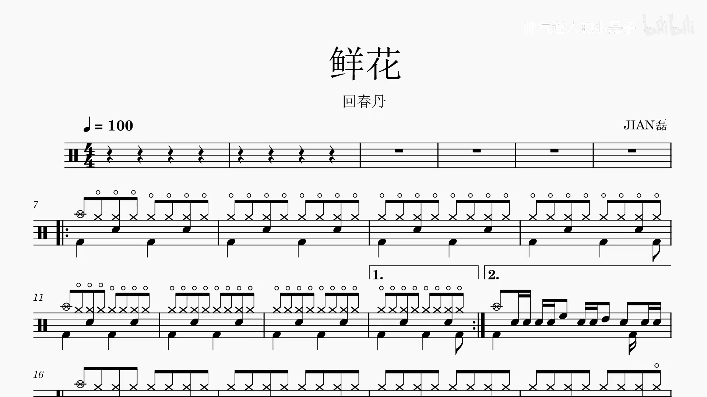
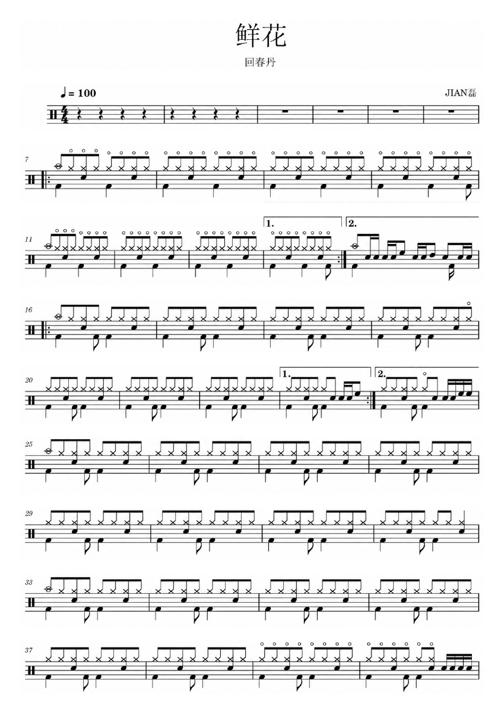

<div align="center">

# 鼓谱整理

### 把 B站视频里的滚动鼓谱，变成能打印、能放上谱架的 A4 PDF。

**[👉 立即使用：drum.kenqia.top](https://drum.kenqia.top/)**

免费 · 无需注册 · 无需安装 · 手机电脑都能用

</div>

---

## 你是不是也这样扒过谱？

看到一首想练的歌，B站有人做了滚动鼓谱视频。于是你开始暂停、截图、拖进度条、再截图，最后拼出一堆大小不一、互相重叠的图片。练到一半还得回去找漏掉的那一行。

鼓谱整理帮你把这件事一次做完：**粘贴链接，等一会儿，下载 PDF**。

<table>
<tr>
<td width="55%" align="center"><b>视频里的样子</b></td>
<td width="45%" align="center"><b>整理后的 A4 PDF</b></td>
</tr>
<tr>
<td></td>
<td></td>
</tr>
</table>

<sub>示例：《鲜花》，演唱回春丹，谱面 JIAN磊，视频来自 B站 UP 主「帅气迷人的小磊子」（<a href="https://www.bilibili.com/video/BV1Yw4m1Y7YH">原视频</a>）。谱面版权归原作者所有。</sub>

## 三步拿到鼓谱

1. **复制链接**：复制 B站鼓谱视频的完整 BV 链接（形如 `https://www.bilibili.com/video/BV…`），或 App 分享的 `https://b23.tv/…` 短链接。网页也支持粘贴整段分享文案。多 P 视频按完整链接或短链接展开后的 `?p=2` 分 P 处理。
2. **粘贴提交**：打开 [drum.kenqia.top](https://drum.kenqia.top/)，粘贴链接，点「整理鼓谱」。
3. **查看下载**：整理完成后，网页会把每一页都显示出来。看一遍没问题，点「下载 A4 PDF」。

> 💡 提交后网页会给你一条专属任务链接。**把它收藏或复制下来**，关掉页面任务也会继续，稍后打开链接就能取结果。这条链接相当于这份鼓谱的钥匙，只分享给信任的人。

## 它会帮你做什么

- **整行拼接**：自动跟着视频滚动，把每一行谱完整接起来，重叠的部分只保留一次。
- **反复不丢**：重复段、一房二房这类后续重复的音乐会按原样保留，不会被当成重复删掉。
- **适合打印**：按 A4 排版，不把一行谱切成两半，所有页面统一缩放，行距和原谱一致。
- **先看再下**：下载前能看到全部页面，哪里不对一眼就能发现。
- **拿不准就直说**：遇到缺段、画面跳变或无法确定怎么接的地方，会直接告诉你失败，而不是给你一份拼错的谱子。

## 哪些视频效果最好

| ✅ 推荐 | ⚠️ 可能不行 |
| --- | --- |
| 白色背景的完整鼓谱 | 谱面被弹幕、人像、贴图挡住 |
| 谱面**从下往上**匀速滚动 | 左右翻页、整页切换 |
| 画面比例全程固定 | 镜头推拉、缩放、移动 |
| 公开视频，不用登录就能看 | 会员专享、需要登录或已下架的视频 |

另外有几个上限：视频最长 10 分钟，画面不超过约 420 万像素（1080p、1440p 都没问题，4K 视频会超出）。

## 常见问题

**要花钱吗？要注册吗？**
都不用。打开网页、粘贴链接就行，不需要登录 B站，也不会读取你的任何账号信息。

**要等多久？**
时间取决于视频长度和服务器忙不忙。人多的时候需要排队，网页会显示你排在第几位。

**结果能保存多久？**
24 小时。过期后 PDF 和预览会被删除，记得及时下载。视频本身在处理完就会清理，不会保存在服务器上。

**PDF 里的谱子一定对吗？**
网站只是把视频里的画面整理拼接，**不会改动或重新识别音符**。原视频里的水印、模糊、播放进度线可能会保留下来。极少数拼接问题程序也可能没发现，演奏前请对照原视频快速核对一遍。

**为什么提示我还有任务在进行？**
为了公平，同一个网络同时只能有一个未完成的任务。学校、公司或家里多人共用网络时，可能会互相占用名额，稍等一会儿再试。

**能上传自己手机里的视频吗？**
网站目前只支持 B站公开链接。需要处理本地视频，可以用下方的命令行工具。

**能转成 MIDI 或者重新打谱吗？**
网站不提供。它的目标是忠实保留原谱面。

## 尊重原作者

鼓谱是扒谱作者花大量时间做出来的。这个工具只是帮你整理自己能看到的内容，方便练习。请只处理你有权使用的内容，不要把整理出的 PDF 用于售卖或冒充原创。喜欢一份谱子，记得去原视频给作者点个赞。

---

<details>
<summary><b>给开发者：命令行、自行部署与 AI Skill</b></summary>

<br>

本仓库包含两个互相独立的产品：

| 产品 | 位置 | 说明 |
| --- | --- | --- |
| Python 命令行与网站 | [`src/drum_score/`](src/drum_score/) | 网站 [drum.kenqia.top](https://drum.kenqia.top/) 的源码。纯图像处理，不调用 AI 模型。支持本地视频。 |
| AI Agent Skill | [`skills/bilibili-drum-score-to-pdf/`](skills/bilibili-drum-score-to-pdf/SKILL.md) | 给 Codex 等视觉 Agent 使用，可由 Agent 逐页查看后交付，并支持可选重绘。 |

两者分别安装、分别测试，互不调用。边界见[架构说明](docs/architecture.md)。

**命令行快速开始**（需要 Python 3.12+，以及 `ffmpeg`、`ffprobe`、`pdftoppm`）：

```sh
python3.12 -m venv .venv
.venv/bin/pip install .
.venv/bin/drum-score ./my-drum-video.mp4 --output ./result
```

处理 B站链接还需要固定版本的 BBDownNext 解析器。完整说明：

- [安装指南](docs/install.md) · [转换参数](docs/script-product/conversion.md)
- [网站运行](docs/script-product/website.md) · [部署](docs/script-product/deployment.md) · [备份与恢复](docs/script-product/maintenance.md)
- [Skill 安装](docs/skill-install.md) · [Skill 验证](docs/skill-verification.md)
- [测试与验证](docs/verification.md) · [全部文档](docs/README.md)

</details>

## 支持鼓谱整理 · Support 鼓谱整理

如果鼓谱整理帮到了你，欢迎支持它继续开发。谢谢你帮这个项目一直走下去 ❤️

If 鼓谱整理 has been useful to you, you can support its continued development. Thank you for helping keep the project going ❤️

<p align="center">
<br>
<sub>微信扫码支持 · WeChat Pay</sub>
</p>

不方便打赏也没关系，给仓库点个 ⭐ Star，或者把 [drum.kenqia.top](https://drum.kenqia.top/) 分享给身边的鼓手，同样是很大的支持。

## 许可

代码与文档使用 [MIT 许可](LICENSE)。示例中的音乐、谱面和视频画面权利归原权利人。
